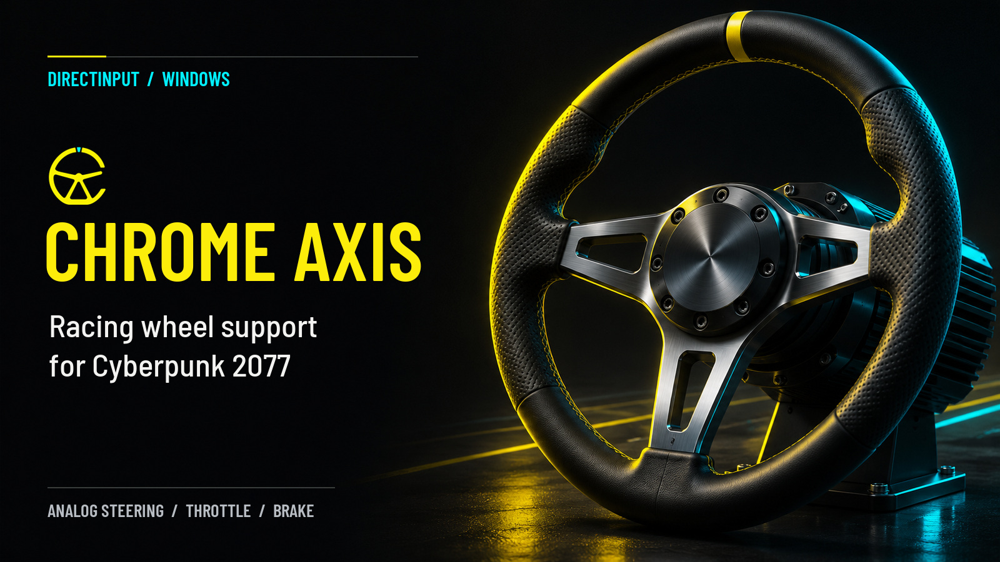
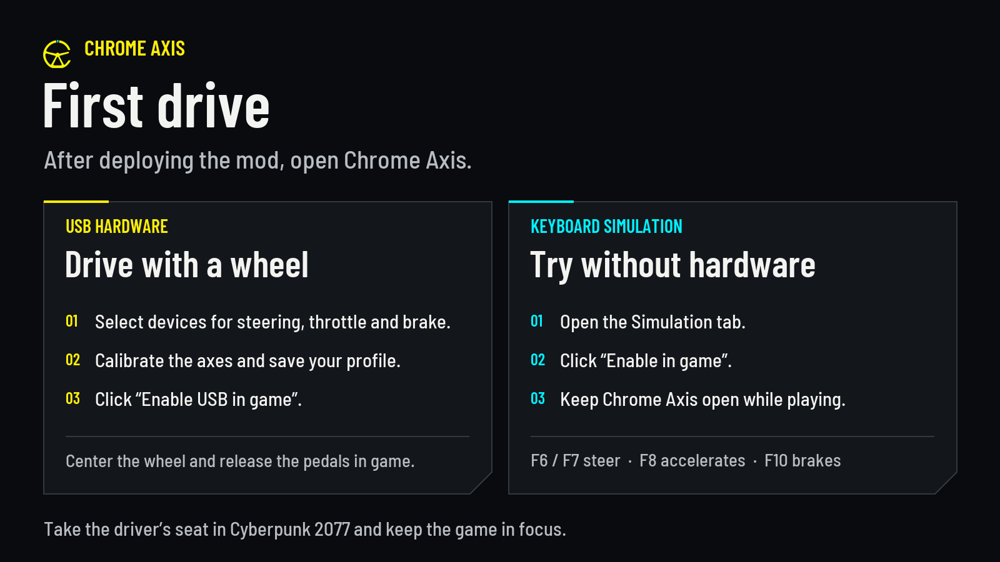
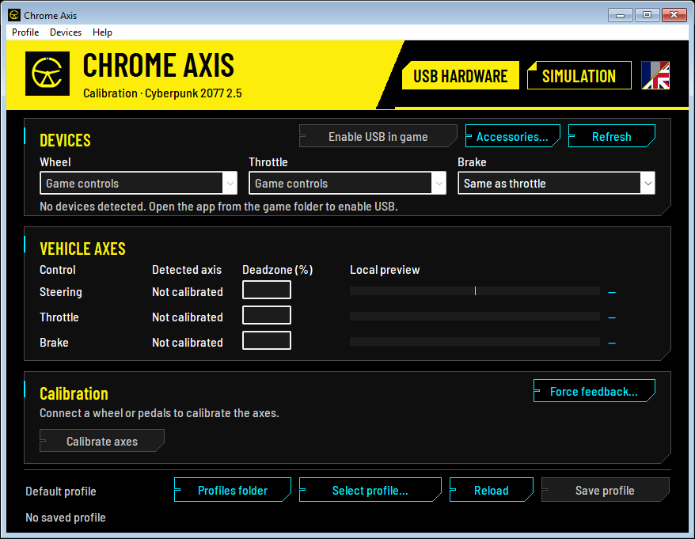
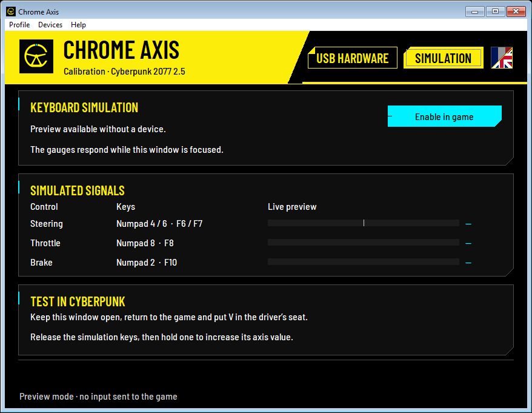
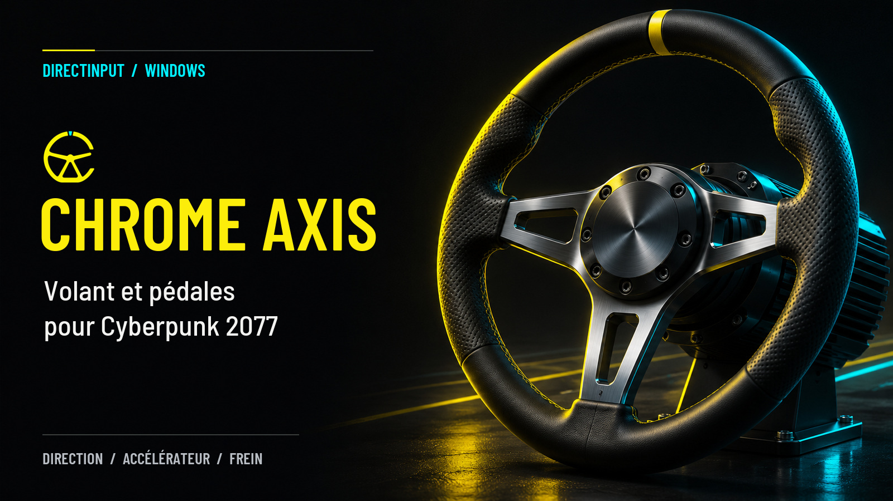
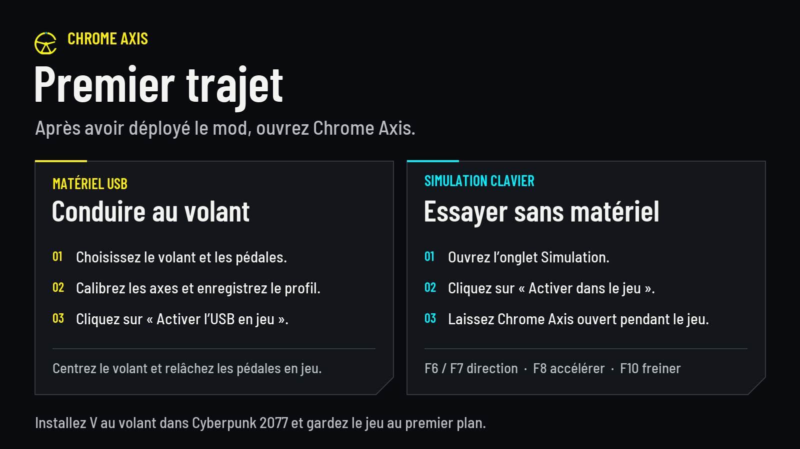
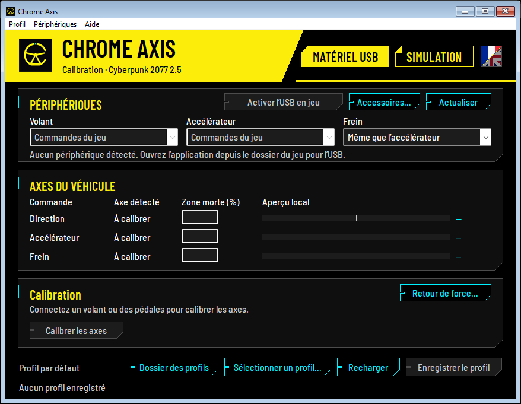
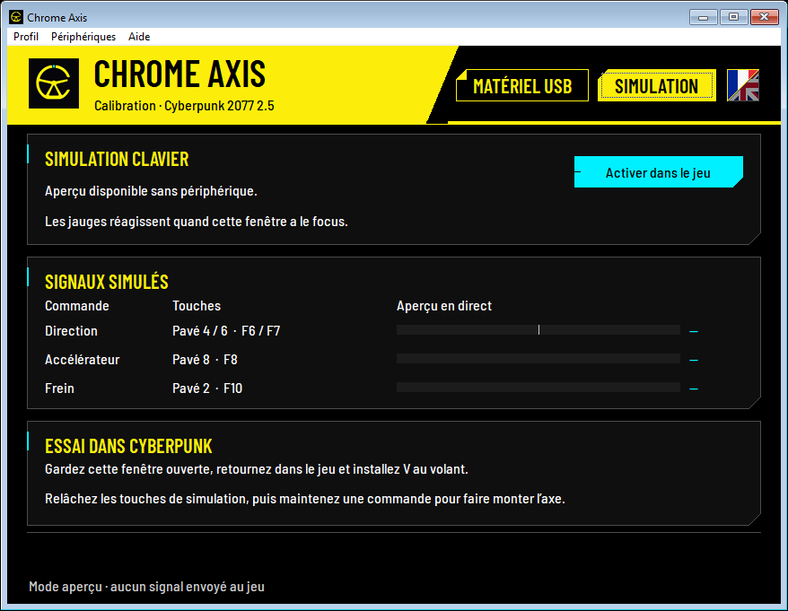

# Chrome Axis sur Nexus Mods

[Voir la mise en page](apercu-description.html) · [Description bilingue à coller](description-bilingue.bbcode.txt) · [Guide de publication](guide-publication.md)

Collez la description bilingue dans le mode source BBCode de l’éditeur **Description**. Elle intègre les visuels 0.4.15 déjà hébergés dans les deux langues. Pour une seule langue, utilisez l’[export anglais](description-en.bbcode.txt) ou l’[export français](description-fr.bbcode.txt).

## Champs Nexus

| Champ | Texte proposé |
| --- | --- |
| Nom du mod EN | Chrome Axis - Steering Wheel and Pedal Support |
| Nom du mod FR | Chrome Axis - Volant et pédales analogiques |
| Version | 0.4.15 |
| Résumé EN | Adds analog steering, throttle and braking to Cyberpunk 2077. Calibrate your USB wheel and pedals, save custom profiles, or try progressive keyboard controls without a wheel. |
| Résumé FR | Ajoute la direction, l’accélération et le freinage analogiques à Cyberpunk 2077. Calibrez votre volant et vos pédales USB, enregistrez vos profils ou testez les commandes progressives au clavier sans volant. |
| Nom du fichier principal EN | Chrome Axis for Cyberpunk 2077 2.5 |
| Nom du fichier principal FR | Chrome Axis pour Cyberpunk 2077 2.5 |
| Description du fichier EN | RED4ext plugin, English/French setup app and in-game status HUD for Cyberpunk 2077 2.5 on Windows x64. |
| Description du fichier FR | Plugin RED4ext, application de configuration FR/EN et indicateur en jeu pour Cyberpunk 2077 2.5 sur Windows x64. |

---

**Chrome Axis 0.4.15 · Cyberpunk 2077 2.5 · Windows x64**

*English first. La version française suit la section anglaise.*

## English

Chrome Axis adds **analog steering, throttle and brake** to Cyberpunk 2077 on PC. Calibrate a USB wheel and pedals on the same base or on separate DirectInput devices. The included app gives you live input readings, adjustable dead zones and named profiles.

- **Wheel and pedals.** Save your profile and enable USB input. You can then close the app.
- **Keyboard simulation.** Try progressive inputs without hardware. Keep the app open while driving.

### New in 0.4.15

The language selector is a square split diagonally to the right of **Simulation**. Click the **French flag in the upper left** or the **British flag in the lower right**. The chosen half lights up immediately. **Restart Chrome Axis** to apply the change.

**Help → Language → Automatic (Windows)** uses French when Windows displays in French and English otherwise. Your app language applies to all profiles. The in-game HUD uses Cyberpunk’s display language, with French for a French game and English for other game languages.

### Requirements and installation

**Chrome Axis 0.4.15** targets **Cyberpunk 2077 2.5 on Windows x64** (`Cyberpunk2077.exe` version **3.0.88.46235**). Install [RED4ext 1.31.1](https://github.com/wopss/RED4ext/releases/tag/v1.31.1) and [redscript 0.5.32](https://github.com/jac3km4/redscript/releases/tag/v0.5.32).

Close the game. Use **Install From File** in Vortex to import the ZIP, then enable and deploy the mod. For a manual install, extract the ZIP to the game folder. Open `red4ext/plugins/chrome_axis/ChromeAxis.exe` from the installed game.

### Drive with a wheel

1. In **USB Hardware**, click **Refresh** and select devices for **Wheel**, **Throttle** and **Brake**. **Game controls** keeps the regular controls for that axis.
2. Click **Calibrate axes**. Capture the wheel at center and both limits, and each pedal at rest and fully pressed. Check for −100% to +100% steering and 0% to 100% per pedal. Adjust **Deadzone (%)** if an input drifts at rest, then click **Save profile**.
3. USB input starts disabled. Click **Enable USB in game** and close Chrome Axis. With V in the driver’s seat and the game in the foreground, center the wheel and release the pedals and paddles to arm them. To stop USB input, open the app and click **Disable USB in game**.

Pedals that share a single axis can use a common rest position with travel in opposite directions. Use separate axes in your driver settings to register both pedals at once. **Select profile…** switches profiles or creates a named copy of your saved setup. Profiles store calibration, dead zones, accessory bindings and force feedback. The game reads the active profile. The USB switch applies across profiles.

*Chrome Axis 0.4.15 in English. The British half of the language selector is highlighted. USB Hardware is shown before connecting a device.*

The in-game HUD shows **MOD LOADED** when Chrome Axis is present, **USB WAITING** while controls get ready and **USB READY** once they are armed. **USB INPUT** flashes when the mod sends an axis value or accessory key. **SIMULATION** indicates that the game receives the keyboard simulation signal.

### Try it with a keyboard

Open **Simulation** and hold a key with the app in the foreground to see its input build in the preview. Click **Enable in game** and **leave the app open**. You can minimize it. Sit in the driver’s seat, bring the game to the foreground and release the keys once to arm the controls.

- **Steer left / right** — F6 / F7 or Numpad 4 / 6.
- **Accelerate / brake** — F8 / F10 or Numpad 8 / 2.

Turn on Num Lock to use the numpad. To end the test, click **Stop simulation**, switch to **USB Hardware** or close Chrome Axis.

*The English Simulation tab shows keyboard shortcuts and input meters in preview mode.*

### Force feedback and accessories

- **Force feedback** requires a DirectInput actuator on the calibrated steering axis. Save the calibration, open **Force feedback…**, enable it for the active profile and start at low strength. Steering effort varies with vehicle speed, mass and sideways motion. You can set 1–35% of nominal DirectInput force, reverse the effect and turn collision jolts off separately.
- **Accessories…** lets you assign buttons, D-pad directions and axes to keys using a visual keyboard. The number row and numpad are separate. **Shifter / paddles…** handles sequential controls and 6-, 7- or 8-speed H-patterns with reverse. Apply the mappings, save them and enable USB input. Manual shifting requires a separate transmission mod with matching keys. H-pattern shifting requires one bindable command per gear in that mod.

### Troubleshooting

- **USB WAITING.** Center the wheel, release the pedals and paddles, and check the inputs in Windows Game Controllers (`joy.cpl`).
- **The app sees movement but the car stays still.** Check `red4ext/logs/chromeaxis-*.log`. Compare `Chrome Axis USB configuration directory` in the log with **Profiles folder** in the app. If the mod log is missing, check `red4ext-*.log` for plugin or script loading errors.
- **Missing `MSVCP140.dll` or `VCRUNTIME140.dll`.** Install the Microsoft Visual C++ v14 x64 Redistributable. [Microsoft download](https://learn.microsoft.com/en-us/cpp/windows/latest-supported-vc-redist?view=msvc-170#latest-supported-redistributable-version)
- **Updates.** Close the game and the app, then back up the entire `Profil` folder. Remove the previous version before installing the new one. Restore the backup and click **Reload**.

The ZIP includes both full setup guides, `README.en.md` in English and `README.md` in French.

### Credits

Unofficial fan mod maintained by EsterOne001. The analog vehicle hook and Cyberpunk 2.5 field layout use Direct Wheel 3.4.1 as a reference. Thanks to Grant Perdue, SERG (natpoh), DesignWithTommy, the RED4ext and redscript contributors, and the Barlow Project Authors. Full credits and licenses are included in the ZIP. [Chrome Axis source](https://github.com/EsterOne001/chrome-axis) · [Grant Perdue’s original project](https://github.com/clevergrant/cp2077-wheel-mod) · [Direct Wheel 3.4.1](https://github.com/DesignWithTommy/cp2077-wheel-mod/releases/tag/v3.4.1) · [SERG’s Moza and Direct Drive Wheel Support](https://www.nexusmods.com/cyberpunk2077/mods/29246)

Codex assisted with the page copy. OpenAI ImageGen created the promotional illustration and removed the background from the in-game HUD logo.

## Français

Chrome Axis ajoute la **direction, l’accélérateur et le frein analogiques** à Cyberpunk 2077 sur PC. Calibrez le volant et les pédales sur la même base ou sur des périphériques DirectInput distincts. L’application propose des jauges en direct, des zones mortes réglables et des profils nommés.

- **Volant et pédalier**. Enregistrez le profil et activez l’USB. Vous pouvez ensuite fermer l’application.
- **Simulation clavier**. Testez les commandes progressives sans matériel. Gardez l’application ouverte pendant la conduite.

### Nouveauté de la 0.4.15

Le sélecteur de langue est un carré divisé en diagonale, à droite de **Simulation**. Cliquez sur le **drapeau français en haut à gauche** ou sur le **drapeau britannique en bas à droite**. La moitié choisie s’illumine aussitôt. **Relancez Chrome Axis** pour appliquer le changement.

**Aide → Langue → Automatique (Windows)** choisit le français si Windows s’affiche en français, et l’anglais dans les autres cas. La langue de l’application s’applique à tous vos profils. Le HUD suit la langue d’affichage de Cyberpunk. Il s’affiche en français si le jeu est en français, et en anglais dans les autres cas.

### Prérequis et installation

**Chrome Axis 0.4.15** cible **Cyberpunk 2077 2.5 sur Windows x64** (`Cyberpunk2077.exe` en version **3.0.88.46235**). Installez [RED4ext 1.31.1](https://github.com/wopss/RED4ext/releases/tag/v1.31.1) et [redscript 0.5.32](https://github.com/jac3km4/redscript/releases/tag/v0.5.32).

Fermez le jeu. Dans Vortex, importez le ZIP avec **Installer depuis un fichier**, puis activez et déployez le mod. Pour une installation manuelle, extrayez le ZIP à la racine du jeu. Ouvrez `red4ext/plugins/chrome_axis/ChromeAxis.exe` depuis le dossier du jeu.

### Conduire au volant

1. Dans **Matériel USB**, cliquez sur **Actualiser** et choisissez les périphériques du **Volant**, de l’**Accélérateur** et du **Frein**. **Commandes du jeu** conserve les commandes habituelles pour l’axe choisi.
2. Cliquez sur **Calibrer les axes**. Capturez le centre et les butées du volant, puis le repos et la pleine course de chaque pédale. Vérifiez que la direction va de −100 % à +100 % et que chaque pédale va de 0 % à 100 %. Ajustez **Zone morte (%)** si une commande bouge au repos, puis cliquez sur **Enregistrer le profil**.
3. L’USB en jeu est désactivé par défaut. Cliquez sur **Activer l’USB en jeu**, puis fermez Chrome Axis. Installez V au siège conducteur, gardez le jeu au premier plan, centrez le volant et relâchez les pédales et les palettes pour armer les commandes. Pour arrêter l’USB, ouvrez l’application et cliquez sur **Désactiver l’USB en jeu**.

Des pédales sur un axe combiné peuvent partager un point de repos, avec des courses opposées. Sélectionnez des axes séparés dans le pilote pour mesurer les deux pédales simultanément. **Sélectionner un profil…** permet de changer de profil ou de créer une copie nommée des réglages enregistrés. Chaque profil garde sa calibration, ses zones mortes, ses affectations d’accessoires et son retour de force. Le jeu lit le profil actif. L’activation USB est commune à tous les profils.

*Chrome Axis 0.4.15 en français. La moitié française du sélecteur est éclairée. L’onglet Matériel USB est affiché avant le branchement d’un périphérique.*

Le HUD affiche **MOD CHARGÉ** lorsque Chrome Axis est présent, **USB EN ATTENTE** tant que les commandes se préparent, puis **USB PRÊT** une fois qu’elles sont armées. **SIGNAL USB** apparaît brièvement à l’envoi d’une valeur d’axe ou d’une touche d’accessoire. **SIMULATION** indique que le jeu reçoit le signal de la simulation clavier.

### Essayer au clavier

Ouvrez **Simulation** et maintenez une touche avec l’application au premier plan pour voir l’entrée progresser dans l’aperçu. Cliquez sur **Activer dans le jeu** et **laissez l’application ouverte**. Vous pouvez la réduire. Installez V au siège conducteur, placez le jeu au premier plan et relâchez les touches pour armer les commandes.

- **Braquer à gauche / à droite** — F6 / F7 ou pavé numérique 4 / 6.
- **Accélérer / freiner** — F8 / F10 ou pavé numérique 8 / 2.

Activez Verr. num. pour utiliser le pavé numérique. Pour terminer l’essai, cliquez sur **Arrêter la simulation**, revenez dans **Matériel USB** ou fermez Chrome Axis.

*L’onglet Simulation en français affiche les raccourcis et les jauges d’entrée en mode aperçu.*

### Retour de force et accessoires

- Le **retour de force** nécessite un actionneur DirectInput sur l’axe de direction calibré. Enregistrez la calibration, ouvrez **Retour de force…**, activez-le pour le profil en cours et commencez à faible intensité. L’effort varie avec la vitesse, la masse et le déplacement latéral du véhicule. Réglez l’intensité de 1 à 35 % de la force nominale DirectInput, inversez le sens au besoin et désactivez les secousses de collision séparément.
- **Accessoires…** associe boutons, directions de croix et axes à des touches grâce au clavier visuel. La rangée de chiffres et le pavé numérique sont distincts. **Boîte / palettes…** couvre le séquentiel et les grilles en H à 6, 7 ou 8 rapports, marche arrière comprise. Appliquez les affectations, enregistrez-les et activez l’USB en jeu. Le changement manuel des rapports nécessite un mod de transmission configuré avec les mêmes touches. Pour une grille en H, ce mod doit accepter une touche par rapport.

### Dépannage

- **USB EN ATTENTE.** Centrez le volant, relâchez les pédales et les palettes, puis vérifiez les commandes dans les contrôleurs de jeu Windows (`joy.cpl`).
- **Les jauges bougent et le véhicule reste immobile.** Consultez `red4ext/logs/chromeaxis-*.log`. Comparez `Chrome Axis USB configuration directory` dans le journal avec le chemin ouvert par **Dossier des profils**. Si le journal du mod est absent, consultez `red4ext-*.log` pour vérifier le chargement du plugin et des scripts.
- **`MSVCP140.dll` ou `VCRUNTIME140.dll` manquant.** Installez le redistribuable Microsoft Visual C++ v14 x64. [Téléchargement Microsoft](https://learn.microsoft.com/en-us/cpp/windows/latest-supported-vc-redist?view=msvc-170#latest-supported-redistributable-version)
- **Mises à jour.** Fermez le jeu et l’application, puis sauvegardez tout le dossier `Profil`. Retirez l’ancienne version avant d’installer la nouvelle. Restaurez la sauvegarde et cliquez sur **Recharger**.

Le ZIP inclut les deux guides complets, `README.md` en français et `README.en.md` en anglais.

### Crédits

Mod de fans non officiel maintenu par EsterOne001. L’intégration des commandes analogiques et la structure des champs de Cyberpunk 2.5 s’appuient sur Direct Wheel 3.4.1. Merci à Grant Perdue, SERG (natpoh), DesignWithTommy, aux contributeurs de RED4ext et de redscript et aux auteurs de Barlow. Les crédits complets et les licences sont dans le ZIP. [Code source de Chrome Axis](https://github.com/EsterOne001/chrome-axis) · [Projet d’origine de Grant Perdue](https://github.com/clevergrant/cp2077-wheel-mod) · [Direct Wheel 3.4.1](https://github.com/DesignWithTommy/cp2077-wheel-mod/releases/tag/v3.4.1) · [Moza and Direct Drive Wheel Support de SERG](https://www.nexusmods.com/cyberpunk2077/mods/29246)

Codex a aidé à rédiger cette fiche. OpenAI ImageGen a servi à créer l’illustration promotionnelle et à détourer le logo affiché dans le HUD.
