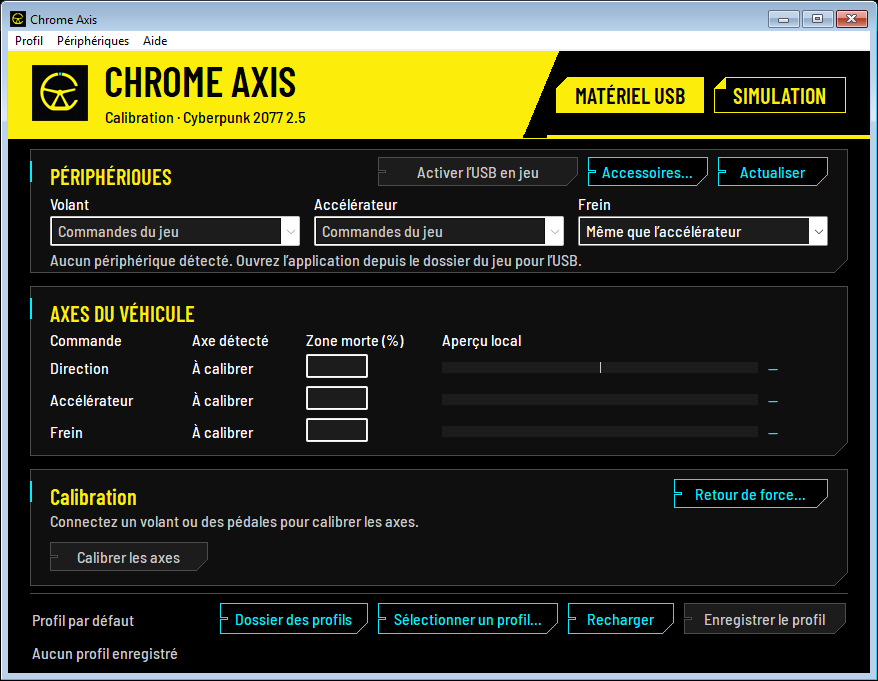

# Chrome Axis

Chrome Axis ajoute la direction, l’accélérateur et le frein analogiques à **Cyberpunk 2077 sur Windows**. Calibrez chaque axe sur un périphérique DirectInput, enregistrez plusieurs profils et affectez des touches aux palettes, leviers et autres accessoires. Le mod propose un retour de force sur les volants compatibles et un mode Simulation pour essayer la conduite au clavier sans matériel.

[English documentation](README.en.md)

Le prototype **0.4.20** cible **Cyberpunk 2077 2.5**, exécutable **3.0.88.46235**. Utilisez **RED4ext 1.31.1**, qui corrige un problème de compilation des scripts de la version 1.31.0. La version de référence de redscript est **0.5.32**. [RED4ext 1.31.1](https://github.com/wopss/RED4ext/releases/tag/v1.31.1) · [redscript 0.5.32](https://github.com/jac3km4/redscript/releases/tag/v0.5.32)

[Installation](#installation-via-vortex) · [Langue](#langue) · [Simulation clavier](#simulation-sans-volant-ni-pédalier) · [Calibration](#calibration-et-profil) · [Diagnostic](#diagnostic-en-jeu) · [Dossiers du projet](#dossiers-du-projet) · [Compilation](#compilation) · [Signaler un problème](#signaler-un-problème)



Chrome Axis est un mod non officiel créé par des fans, sans affiliation avec CD PROJEKT RED. Le projet est maintenu par EsterOne001. [Profil GitHub](https://github.com/EsterOne001) · [Règles de CD PROJEKT RED sur les contenus de fans](https://www.cdprojektred.com/en/fan-content)

## Installation via Vortex

Pour obtenir le ZIP du mod à partir de ce dépôt, suivez les [instructions de compilation](#compilation). Pour remplacer une version déjà installée, suivez les étapes de [mise à jour](#mise-à-jour-depuis-une-version-précédente).

1. Fermez le jeu.
2. Dans l’onglet **Mods** de Vortex, importez le ZIP de Chrome Axis avec **Installer depuis un fichier**, ou déposez le ZIP sur la zone d’importation. Installez, activez puis déployez le mod.
3. Après le déploiement, ouvrez Chrome Axis (`ChromeAxis.exe`) depuis `red4ext/plugins/chrome_axis` dans le dossier du jeu. Si Vortex lance l’application depuis son dossier de préparation et utilise des liens physiques, l’application retrouve automatiquement le dossier du jeu quand une seule installation correspond. Évitez de lancer l’exécutable directement depuis le ZIP. Le bouton **Dossier des profils** permet de vérifier où se trouvent vos réglages.

Le profil et l’état d’activation USB se trouvent dans `red4ext/plugins/chrome_axis/Profil`, à côté de `licenses` et `scripts`. Le menu **Profil** permet d’ouvrir cet emplacement. Le mod conserve les affectations clavier et souris de Cyberpunk.

Si Windows signale `MSVCP140.dll` ou `VCRUNTIME140.dll` manquant, installez le redistribuable Microsoft Visual C++ v14 x64. [Téléchargement officiel Microsoft](https://learn.microsoft.com/en-us/cpp/windows/latest-supported-vc-redist?view=msvc-170#latest-supported-redistributable-version)

### Mise à jour depuis une version précédente

1. Fermez le jeu. Dans l’ancienne application, utilisez **Profil → Sauvegarder les profils…** et choisissez un emplacement en dehors du dossier du jeu pour garder la sauvegarde pendant la mise à jour. Si la commande est absente, ouvrez le dossier des profils depuis le même menu et faites-en une copie complète.
2. Fermez l’ancienne application, désactivez l’ancien mod dans Vortex et déployez le changement. Pour une installation manuelle, retirez le dossier de l’ancien plugin de `red4ext/plugins` après avoir sauvegardé les réglages.
3. Installez et déployez la nouvelle version. Ouvrez son `ChromeAxis.exe` et choisissez **Profil → Restaurer les profils…**. Sélectionnez le dossier de sauvegarde ou la copie de l’ancien dossier `Profil`. L’application applique les réglages au dossier `red4ext/plugins/chrome_axis/Profil` du jeu et recharge le profil actif.

## Langue

Dans le carré à droite de **Simulation**, cliquez sur le drapeau français en haut à gauche ou sur le drapeau britannique en bas à droite. La moitié choisie s’illumine aussitôt. Relancez Chrome Axis pour appliquer la langue. Vous pouvez aussi choisir **Français**, **English** ou **Automatique (Windows)** dans **Aide → Langue**. Le réglage automatique utilise le français si l’interface de Windows est en français et l’anglais pour les autres langues. La langue de l’application déployée s’enregistre dans le dossier `Profil` du mod et s’applique à tous les profils.

Le texte du HUD suit la langue d’affichage de Cyberpunk 2077. Il s’affiche en français si le jeu est en français et en anglais dans les autres langues. Les journaux techniques du plugin utilisent l’anglais.

## Simulation sans volant ni pédalier

1. Dans l’application, ouvrez l’onglet **Simulation**. Avec cette fenêtre au premier plan, maintenez une touche de commande pour voir l’axe monter progressivement dans l’aperçu.
2. Cliquez sur **Activer dans le jeu**. Laissez l’application ouverte. Vous pouvez la réduire.
3. Lancez Cyberpunk 2077 avec Chrome Axis déployé par Vortex, ou revenez au jeu s’il utilise déjà `ChromeAxis.dll`. Installez V au siège conducteur, relâchez les touches de simulation pour armer les axes, puis testez les commandes avec le jeu au premier plan.

| Commande | Pavé numérique avec Verr. num. activé | Autre touche |
| --- | --- | --- |
| Braquer à gauche | 4 | F6 |
| Braquer à droite | 6 | F7 |
| Accélérer | 8 | F8 |
| Freiner | 2 | F10 |

Le journal du plugin dans `red4ext/logs` indique `Keyboard simulation active` lorsque le jeu prend en compte ce mode et `First simulated analog input applied` au premier mouvement transmis au véhicule. Pour terminer l’essai, cliquez sur **Arrêter la simulation**, repassez dans l’onglet **Matériel USB** ou fermez l’application.

## Calibration et profil

1. Dans l’onglet **Matériel USB**, actualisez la liste et choisissez un périphérique pour le **Volant**, l’**Accélérateur** et le **Frein**. Si les pédales sont raccordées à la base, choisissez **Même que le volant** pour l’accélérateur et **Même que l’accélérateur** pour le frein. Choisissez **Commandes du jeu** pour conserver le clavier ou la manette sur un axe.
2. Cliquez sur **Calibrer les axes**. À chaque étape, l’animation et la consigne indiquent la position à prendre sur le périphérique affiché. Une fois en position, cliquez sur **Capturer la position** et gardez la commande immobile jusqu’à la fin de la capture. Si plusieurs axes réagissent, sélectionnez celui qui correspond à la commande demandée. **Précédent** permet de refaire une position tout en gardant les captures antérieures.
3. Dans **Vérification**, actionnez chaque commande et contrôlez la jauge correspondante. La direction doit aller de −100 % à +100 % et chaque pédale de 0 % à 100 %, avec un retour à zéro au repos. Utilisez le bouton de la commande à reprendre, par exemple **Refaire le frein**, pour conserver les autres mesures. Cliquez sur **Terminer** pour revenir à la fenêtre principale et ajuster les zones mortes si nécessaire.
4. Cliquez sur **Enregistrer le profil** pour écrire `chrome_axis.ini` dans le dossier du profil actif. Cliquez sur **Recharger** pour relire les réglages enregistrés.

Si le pilote expose les deux pédales sur un même axe, la calibration accepte un point de repos commun avec des courses opposées. Choisissez des axes séparés dans le pilote pour mesurer les deux pressions simultanément.

Pour reprendre une mesure, ouvrez **Calibrer séparément…**, puis choisissez un axe ou un périphérique. Le choix d’un périphérique reprend tous les axes de conduite qui lui sont affectés. Les autres mesures et les affectations d’accessoires sont conservées. Enregistrez le profil pour appliquer le résultat.

### Plusieurs profils

**Dossier des profils** ouvre le dossier qui contient les réglages. Dans **Sélectionner un profil…**, choisissez **Profil par défaut** pour retrouver votre calibration existante ou créez une copie nommée à partir des réglages enregistrés. Chaque profil garde ses axes, ses accessoires et son retour de force. **Enregistrer le profil** et **Recharger** agissent sur la sélection actuelle. Le jeu prend la même sélection au prochain contrôle des réglages. L’activation USB reste commune à tous les profils.

Les commandes **Sauvegarder les profils…** et **Restaurer les profils…** du menu **Profil** incluent le profil par défaut, tous les profils nommés, la calibration et les zones mortes, les affectations, le retour de force, le profil actif, l’activation USB et la langue. Fermez le jeu avant de restaurer. Une copie des réglages précédents reste disponible dans `Profil/Sauvegardes`. Relancez Chrome Axis si la langue a changé.

### Retour de force

Après avoir enregistré l’axe de direction, ouvrez **Retour de force…** depuis **Matériel USB**. Le panneau vérifie si le pilote expose un actionneur DirectInput sur cet axe. Activez l’effet pour le profil courant et commencez à faible intensité. Le réglage va de 1 à 35 % de la force nominale DirectInput. Les chocs peuvent être désactivés séparément et le sens peut être inversé si le volant pousse vers la butée au lieu de revenir au centre.

L’effort de direction varie avec la vitesse, la masse du véhicule et son déplacement latéral. Les collisions signalées par le jeu ajoutent une secousse brève dont l’intensité dépend du choc. Le mod coupe ses effets quand le joueur quitte la conduite, que le jeu perd le premier plan ou que le volant cesse de répondre. Le profil et les commandes restent utilisables si le pilote ne prend pas en charge l’effet.

## Boîtes de vitesses, palettes et autres accessoires

Dans **Accessoires…** et **Boîte / palettes…**, cliquez sur le bouton de touche pour ouvrir le clavier visuel, puis sur la touche à attribuer. La rangée de chiffres et le pavé numérique sont distincts. Vous pouvez fermer le clavier sans modifier la sélection.

1. Ouvrez **Matériel USB → Accessoires…**, sélectionnez le périphérique DirectInput puis cliquez sur **Boîte / palettes…**. Si le levier ou les palettes passent par la base, sélectionnez le volant. Pour un appareil USB autonome, sélectionnez son entrée Windows.
2. En mode **Séquentiel / palettes**, capturez les commandes de montée et de descente. Le mode numérique détecte les boutons ou directions de croix. Si le pilote expose un axe, capturez le repos et chaque butée. Affectez les mêmes touches dans le mod de transmission.
3. En mode **Boîte en H**, sélectionnez la grille de 6, 7 ou 8 rapports et capturez chaque position disponible, marche arrière comprise, en revenant au point mort entre les positions. Associez chaque position à une touche distincte. Pour piloter les rapports dans Cyberpunk, le mod de transmission doit proposer une commande par rapport.
4. Cliquez sur **Appliquer** dans l’assistant, puis sur **Enregistrer** dans le panneau **Accessoires…**. Activez ensuite l’USB en jeu. Les affectations se trouvent dans le fichier `accessories.ini` du profil actif et peuvent servir sans profil d’axes.

**Manual Transmission V10 4.3** propose des commandes séquentielles de montée et de descente, réaffectables dans son menu. L’assistant propose **Pavé + / Pavé −** pour éviter les flèches **↑ / ↓**, déjà utilisées par Cyberpunk pour l’accélération et le freinage. Réglez les mêmes touches dans V10. Pour l’embrayage, capturez la pédale comme un axe d’accessoire et choisissez une touche sans modificateur, puis reportez-la dans V10. L’essai des deux mods ensemble reste à faire. [Commandes de V10](https://www.nexusmods.com/cyberpunk2077/mods/28342), [FAQ sur le séquentiel et la grille en H](https://www.nexusmods.com/cyberpunk2077/mods/28342?tab=posts).

Le panneau **Accessoires…** permet aussi d’associer individuellement un bouton, une direction de croix ou un axe. **Espace** commande le frein à main numérique par défaut. La touche reste enfoncée tant que la commande est active. Un axe déclenche la touche à 55 % de sa course mesurée et la relâche à 35 %.

### Branchement sur PC

| Matériel | Périphérique à sélectionner dans Chrome Axis |
| --- | --- |
| Logitech Driving Force Shifter, RS H-Shifter, RS Shifter & Handbrake | Base Logitech pour le Driving Force Shifter. Les modèles RS peuvent apparaître séparément en USB ou sur une base compatible. Le RS H-Shifter raccordé via adaptateur aux G29/G920/G923 expose 1 à 6 et la marche arrière. [Driving Force](https://secure.logitech.com/assets/54130/3/driving-force-shifter.pdf), [RS H-Shifter](https://www.logitech.com/content/dam/support/simulation/rs-h-shifter/rs-h-shifter-setup-guide-amr.pdf), [RS Shifter & Handbrake](https://www.logitech.com/assets/70192/2/rs_shifter_%26_handbrake_web_qsg_emea.pdf) |
| Thrustmaster TH8A, TH8S, TSS Handbrake | USB direct pour accéder à tous les modes PC. Le TH8S peut apparaître sous le nom `T500 RS Gear Shift`. Par la base DIN, le TH8A et le TSS offrent uniquement le séquentiel sur PC. [Branchement Thrustmaster](https://support.thrustmaster.com/en/kb/1801-en/), [manuel TH8S](https://ts.thrustmaster.com/download/accessories/Manuals/TH8/TH8S_Shifter_Manual_EN.pdf) |
| Fanatec ClubSport Shifter SQ V1.5 | Base Fanatec sur le port **Shifter 1** ou **ClubSport USB Adapter** configuré en mode shifter. Effectuez la calibration Fanatec en mode H. [Guide Fanatec](https://www.fanatec.com/us/en/explorer/products/shifters/clubsport-shifter-sq-v15/) |
| MOZA HGP, SGP, HBP | Accessoire en USB direct ou base MOZA compatible via RJ11. Le HGP offre 7 rapports et la marche arrière, le SGP est séquentiel et le HBP est un frein à main analogique. [Guides MOZA](https://support.mozaracing.com/en/support/solutions/articles/70000684149-shifters-handbrakes-user-manual-tutorial) |

Chrome Axis lit jusqu’à huit axes, 128 boutons et quatre croix par périphérique DirectInput. Le bouton, l’axe ou la direction à capturer dépend du pilote et du branchement. Si une commande manque, ouvrez `joy.cpl` et vérifiez qu’elle réagit dans les propriétés du contrôleur Windows.

## Essai en jeu avec le matériel USB

L’USB en jeu est désactivé par défaut. Depuis l’application installée dans le dossier du jeu, enregistrez une calibration ou des affectations, puis cliquez sur **Activer l’USB en jeu** dans l’onglet **Matériel USB**. Fermez Chrome Axis, installez V au siège conducteur et laissez le jeu au premier plan. Centrez le volant et relâchez les pédales et les palettes pour armer les commandes.

Le logo de Chrome Axis et le texte du HUD changent de couleur ensemble, sans panneau de fond. La conduite USB utilise le profil enregistré et fonctionne avec l’application fermée.

| Couleur | État en jeu |
| --- | --- |
| Gris clair | **MOD CHARGÉ** indique que le mod est présent. |
| Ambre | **USB EN ATTENTE** s’affiche si les commandes configurées ne sont pas prêtes. |
| Cyan | **USB PRÊT** indique que les commandes configurées sont armées. |
| Vert | **SIGNAL USB** apparaît brièvement après l’application d’un axe au véhicule ou l’envoi d’une touche d’accessoire à Windows. |
| Violet | **SIMULATION** indique que le jeu reçoit le signal de l’application ouverte en mode Simulation. |

Si les jauges bougent dans l’application et que le véhicule ne réagit pas, consultez le journal `chromeaxis-*.log` le plus récent dans `red4ext/logs` après un essai. Si ce journal est vide ou absent, consultez aussi `red4ext-*.log` pour vérifier le chargement du plugin et la compilation des scripts.

- `Chrome Axis USB configuration directory` indique le dossier réellement lu par le plugin. Comparez-le au dossier ouvert par le menu **Profil** de l’application.
- `USB requested` et `USB wheel profile loaded` confirment que le plugin a trouvé l’activation et chargé le profil d’axes. Une erreur DirectInput indique l’étape qui a échoué et le code Windows correspondant.
- `USB axes` indique l’état de chaque axe : `waiting for neutral` demande de centrer ou relâcher la commande, `device unavailable` indique que le périphérique ne fournit pas de données, et `axis unavailable` indique que l’axe enregistré n’est pas exposé par le pilote. Dans ce dernier cas, vérifiez la configuration du pilote et recalibrez l’axe.
- `First analog input applied` et `First USB accessory key sent` distinguent la transmission des axes de celle des touches. Si une touche est envoyée sans changement de rapport, vérifiez que le mod de transmission utilise la même touche.

Sur un véhicule à l’arrêt, essayez de braquer, d’accélérer et de freiner progressivement. Vérifiez aussi la marche arrière, le clavier avec le volant au centre, la pause, le passage en mode photo et le retour après Alt-Tab. Testez avec la conduite automatique désactivée.

Débranchez ensuite un périphérique. Ses commandes doivent revenir au repos et les autres périphériques doivent rester utilisables. Rebranchez-le et relâchez ses commandes pour les réarmer. Pour un accessoire, vérifiez aussi que la touche est relâchée en quittant le siège conducteur ou en changeant de fenêtre.

Pour arrêter l’envoi des axes USB pendant la partie, passez à l’application et cliquez sur **Désactiver l’USB en jeu**. La conduite reprend avec les commandes habituelles au retour dans Cyberpunk. Le choix d’activation USB est conservé quand vous fermez l’application.

Pour retirer Chrome Axis, fermez le jeu et Chrome Axis, puis désactivez ou retirez le mod dans Vortex et déployez les changements. Sauvegardez le dossier `Profil` avant la désinstallation si vous souhaitez réutiliser vos réglages.

## Diagnostic en jeu

Ouvrez **Diagnostic…** dans **Matériel USB** ou dans le menu **Aide**. Le panneau affiche l’état envoyé par le plugin de cette installation de Cyberpunk. Lancez le jeu, installez V au volant, activez l’USB et actionnez vos commandes. En revenant dans Chrome Axis, consultez les dernières valeurs appliquées et leur ancienneté.

- **Direction, accélérateur et frein.** Le panneau distingue un périphérique introuvable, un axe absent et une commande qui attend de revenir au neutre. Une commande armée est prête. La valeur appliquée apparaît quand Chrome Axis a effectivement modifié cette commande dans le jeu.
- **Accessoires.** Le panneau montre combien d’affectations sont armées et la dernière touche que Windows a acceptée. Le rapport engagé dépend du mod de transmission.
- **Retour de force.** Le panneau indique si un effet est actif, en attente ou indisponible selon le résultat des appels au pilote.

Le panneau indique quand Cyberpunk n’est plus au premier plan ou quand les données du plugin ne sont plus récentes. La dernière valeur appliquée aide à diagnostiquer un essai après Alt-Tab. Pour l’USB, l’application peut rester ouverte pendant cet essai.

## Dossiers du projet

- `src/core/` contient la lecture DirectInput, la calibration, les profils et la logique partagée par l’application et le plugin.
- `src/app/` contient l’application de configuration Windows, ses dialogues et ses traductions. `main_window.cpp` est le point d’entrée de l’application.
- `src/plugin/` contient le plugin RED4ext qui transmet les commandes au jeu. `scripts/` contient le script REDscript pour le contexte de conduite et le HUD.
- `include/chrome_axis/` contient les en-têtes des modules partagés et des interfaces Windows.
- `assets/` contient les ressources Windows, l’icône, les polices Barlow, les ressources du HUD et la notice du dossier de profils.
- `tests/` contient les tests automatisés exécutés avec CTest. `docs/` rassemble la vérification manuelle et les audits archivés.
- `NexusMods/` rassemble la fiche, l’aperçu, les textes BBCode et les médias de publication. [Guide de publication Nexus Mods](https://github.com/EsterOne001/chrome-axis/blob/main/NexusMods/guide-publication.md)
- `build/` contient les sorties locales de compilation. `out/` contient les ZIP de distribution.

## Compilation

Utilisez PowerShell avec Visual Studio Build Tools, le SDK Windows et une version de CMake compatible avec votre générateur Visual Studio. Les commandes ci-dessous ciblent Visual Studio 2026 en x64. La configuration récupère le SDK RED4ext au commit compatible avec Cyberpunk 2.5 épinglé dans [`CMakeLists.txt`](CMakeLists.txt). `-DCHROME_AXIS_BUILD_PLUGIN=OFF` permet de compiler l’utilitaire seul.

```powershell
cmake -S . -B build/msvc -G "Visual Studio 18 2026" -A x64
cmake --build build/msvc --config Release
ctest --test-dir build/msvc -C Release --output-on-failure
cmake --install build/msvc --config Release --prefix build/package-chrome-axis
New-Item -ItemType Directory -Path out -Force | Out-Null
Compress-Archive -Path 'build/package-chrome-axis/*' -DestinationPath 'out/ChromeAxis-0.4.20-Cyberpunk-2.5.zip'
```

Le répertoire `build/package-chrome-axis` contient les dossiers à placer à la racine du ZIP pour Vortex. Les tests CTest couvrent la calibration et les pédales combinées, la résolution du dossier du jeu, les profils nommés, le réarmement des accessoires, la capture des rapports, la simulation clavier, le calcul du retour de force et la communication du diagnostic.

Après avoir déployé le ZIP via Vortex, suivez la liste de vérification pour tester le matériel et le comportement en jeu. [Essais manuels](https://github.com/EsterOne001/chrome-axis/blob/main/docs/manual-validation.md#français)

## Signaler un problème

Indiquez les versions de Chrome Axis, de Cyberpunk 2077, de RED4ext et de redscript, ainsi que les étapes pour reproduire le problème. Pour un souci matériel, précisez le modèle, le type de branchement et le comportement observé dans `joy.cpl`. Pour un souci en jeu, joignez un extrait pertinent de `red4ext/logs/chromeaxis-*.log` en masquant vos chemins personnels. [Ouvrir un ticket sur GitHub](https://github.com/EsterOne001/chrome-axis/issues)

## Licence

Le code de Chrome Axis est distribué sous licence MIT. Les composants tiers gardent leurs licences respectives. [Licence MIT](LICENSE) · [Licences des composants tiers](THIRD_PARTY_NOTICES.md)

## Crédits

Le thème reprend le jaune `#FCEE0A`, le cyan `#00F0FF` et les boutons à encoche du site officiel français. L’application utilise Blender Pro et Refinery 25 si Windows les détecte. Les polices Barlow Condensed et Barlow Semi Condensed sous licence SIL OFL 1.1 sont intégrées comme solution de secours. [Cyberpunk 2077](https://www.cyberpunk.net/us/fr/) · [Licence Barlow](https://github.com/google/fonts/blob/main/ofl/barlowcondensed/OFL.txt)

Le branchement sur les commandes analogiques et la structure des champs de Cyberpunk 2.5 s’appuient sur le travail de Grant Perdue, SERG (natpoh) et DesignWithTommy sur Direct Wheel. [Sources de Direct Wheel 3.4.1](https://github.com/DesignWithTommy/cp2077-wheel-mod/tree/v3.4.1)
