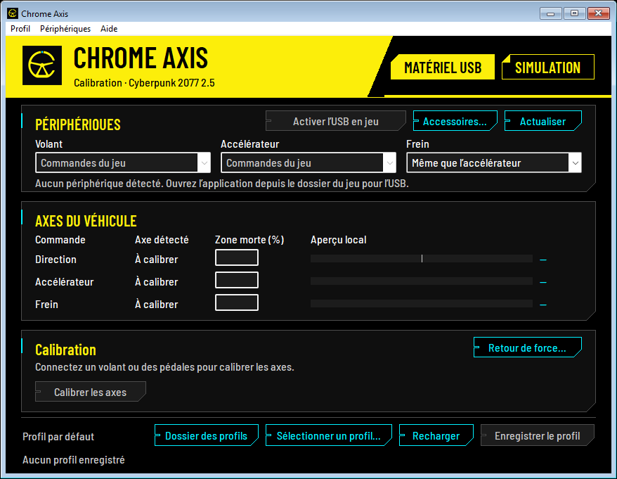

# Chrome Axis

Chrome Axis ajoute la direction, l’accélérateur et le frein analogiques à **Cyberpunk 2077 sur Windows**. Calibrez chaque axe sur un périphérique DirectInput, enregistrez plusieurs profils et affectez des touches aux palettes, leviers et autres accessoires. Le mod propose un retour de force sur les volants compatibles et un mode Simulation pour essayer la conduite au clavier sans matériel.

[English documentation](README.en.md)

La version **0.4.73** cible **Cyberpunk 2077 2.5**, exécutable **3.0.88.46235**. Utilisez **RED4ext 1.31.1**, qui corrige un problème de compilation des scripts de la version 1.31.0. La version de référence de redscript est **0.5.32**. [RED4ext 1.31.1](https://github.com/wopss/RED4ext/releases/tag/v1.31.1) · [redscript 0.5.32](https://github.com/jac3km4/redscript/releases/tag/v0.5.32)

[Installation](#installation-via-vortex) · [Langue](#langue) · [Simulation clavier](#simulation-sans-volant-ni-pédalier) · [Calibration](#calibration-et-profil) · [Diagnostic](#diagnostic-en-jeu) · [Dossiers du projet](#dossiers-du-projet) · [Compilation](#compilation) · [Signaler un problème](#signaler-un-problème)



Chrome Axis est un mod non officiel créé par des fans, sans affiliation avec CD PROJEKT RED. Le projet est maintenu par EsterOne001. [Profil GitHub](https://github.com/EsterOne001) · [Règles de CD PROJEKT RED sur les contenus de fans](https://www.cdprojektred.com/en/fan-content)

## Installation via Vortex

Pour obtenir le ZIP du mod à partir de ce dépôt, suivez les [instructions de compilation](#compilation). Pour remplacer une version déjà installée, suivez les étapes de [mise à jour](#mise-à-jour-depuis-une-version-précédente).

1. Fermez le jeu.
2. Dans l’onglet **Mods** de Vortex, importez le ZIP de Chrome Axis avec **Installer depuis un fichier**, ou déposez le ZIP sur la zone d’importation. Installez, activez puis déployez le mod.
3. Après le déploiement, ouvrez Chrome Axis (`ChromeAxis.exe`) depuis `red4ext/plugins/chrome_axis` dans le dossier du jeu. Si Vortex lance l’application depuis son dossier de préparation et utilise des liens physiques, l’application retrouve automatiquement le dossier du jeu quand une seule installation correspond. Évitez de lancer l’exécutable directement depuis le ZIP. Le bouton **Dossier des profils** permet de vérifier où se trouvent vos réglages.

Le profil et l’état d’activation USB se trouvent dans `red4ext/plugins/chrome_axis/Profil`, à côté de `licenses` et `scripts`. Le menu **Profil** permet d’ouvrir cet emplacement. Le mod conserve les affectations clavier et souris de Cyberpunk.

Si Windows signale `MSVCP140.dll` ou `VCRUNTIME140.dll` manquant, installez le redistribuable Microsoft Visual C++ v14 x64. [Téléchargement officiel Microsoft](https://learn.microsoft.com/en-us/cpp/windows/latest-supported-vc-redist?view=msvc-170#latest-supported-redistributable-version)

### Mise à jour depuis une version précédente

1. Fermez le jeu. Dans l’ancienne application, utilisez **Profil → Sauvegarder les profils…** et choisissez un emplacement en dehors du dossier du jeu pour garder la sauvegarde pendant la mise à jour. Si la commande est absente, ouvrez le dossier des profils depuis le même menu et faites-en une copie complète.
2. Fermez l’ancienne application, désactivez l’ancien mod dans Vortex et déployez le changement. Pour une installation manuelle, retirez le dossier de l’ancien plugin de `red4ext/plugins` après avoir sauvegardé les réglages.
3. Installez et déployez la nouvelle version. Ouvrez son `ChromeAxis.exe` et choisissez **Profil → Restaurer les profils…**. Sélectionnez le dossier de sauvegarde ou la copie de l’ancien dossier `Profil`. L’application applique les réglages au dossier `red4ext/plugins/chrome_axis/Profil` du jeu et recharge le profil actif.

## Langue

Dans le carré à droite de **Simulation**, cliquez sur le drapeau français en haut à gauche ou sur le drapeau britannique en bas à droite. La moitié choisie s’illumine aussitôt. Relancez Chrome Axis pour appliquer la langue. Vous pouvez aussi choisir **Français**, **English** ou **Automatique (Windows)** dans **Aide → Langue**. Le réglage automatique utilise le français si l’interface de Windows est en français et l’anglais pour les autres langues. La langue de l’application déployée s’enregistre dans le dossier `Profil` du mod et s’applique à tous les profils.

Le texte du HUD suit la langue d’affichage de Cyberpunk 2077. Il s’affiche en français si le jeu est en français et en anglais dans les autres langues. Les journaux techniques du plugin utilisent l’anglais.

## Simulation sans volant ni pédalier

1. Ouvrez **Aide → Outils de test → Simulation clavier…**. Avec l’application au premier plan, maintenez une touche de commande pour voir l’axe monter progressivement dans l’aperçu.
2. Depuis l’application déployée, cliquez sur **Activer dans le jeu** dans le bandeau. La demande est réservée à cette installation de Cyberpunk. Laissez l’application ouverte. Vous pouvez la réduire.
3. Lancez Cyberpunk 2077 avec Chrome Axis déployé par Vortex, ou revenez au jeu s’il utilise déjà `ChromeAxis.dll`. Installez V au siège conducteur, relâchez les touches de simulation pour armer les axes, puis testez les commandes avec le jeu au premier plan.

| Commande | Pavé numérique avec Verr. num. activé | Autre touche |
| --- | --- | --- |
| Braquer à gauche | 4 | F6 |
| Braquer à droite | 6 | F7 |
| Accélérer | 8 | F8 |
| Freiner | 2 | F10 |

Le journal du plugin dans `red4ext/logs` indique `Keyboard simulation active` lorsque le jeu prend en compte ce mode et `First simulated analog input applied` au premier mouvement transmis au véhicule. Pour terminer l’essai, cliquez sur **Arrêter la simulation** dans le bandeau ou **Retour** en bas à droite, ou fermez l’application.

L’application affiche **Simulation demandée** jusqu’à ce que le plugin confirme le mode en conduite. Une copie autonome permet de tester les jauges dans l’aperçu. Pour activer la simulation en jeu, déployez ensemble l’application et le plugin du même ZIP et ouvrez l’EXE du mod dans le dossier de Cyberpunk.

## Calibration et profil

Les réglages sont accessibles depuis **Matériel USB** et le menu **Périphériques**.

| Commande | Réglages |
| --- | --- |
| **Volant…** | Calibration du volant, réponse de direction et retour de force. |
| **Pédales…** | Calibration, courbes et stabilisation du frein et de l’accélérateur. |
| **Transmission…** | Boîte et palettes, touche AUTO / MANUEL et embrayage. |
| **Frein à main…** | Calibration du levier progressif, aperçu et plafond. |
| **Accessoires…** | Affectations de touches pour les autres boutons, axes et directions de croix. |

1. Dans l’onglet **Matériel USB**, actualisez la liste et choisissez un périphérique pour le **Volant**, l’**Accélérateur** et le **Frein**. Si les pédales sont raccordées à la base, choisissez **Même que le volant** pour l’accélérateur et **Même que l’accélérateur** pour le frein. Choisissez **Commandes du jeu** pour conserver le clavier ou la manette sur un axe.
2. Cliquez sur **Calibrer les axes**. À chaque étape, l’animation et la consigne indiquent la position à prendre sur le périphérique affiché. Une fois en position, cliquez sur **Capturer la position** et gardez la commande immobile jusqu’à la fin de la capture. Si plusieurs axes réagissent, sélectionnez celui qui correspond à la commande demandée. **Précédent** permet de refaire une position tout en gardant les captures antérieures.
3. Dans **Vérification**, actionnez chaque commande. L’état de chaque axe indique si vous devez recentrer le volant, relâcher une pédale ou rebrancher un périphérique. La jauge de course réagit dès qu’une mesure est disponible. La direction doit aller de −100 % à +100 % et chaque pédale de 0 % à 100 %, avec un retour à zéro au repos. Utilisez le bouton de la commande à reprendre, par exemple **Refaire le frein**, pour conserver les autres mesures. Cliquez sur **Terminer** pour revenir à la fenêtre principale et ajuster les zones mortes si nécessaire.
4. Cliquez sur **Enregistrer le profil** pour écrire `chrome_axis.ini` dans le dossier du profil actif. Cliquez sur **Recharger** pour relire les réglages enregistrés.

Si le pilote expose les deux pédales sur un même axe, la calibration accepte un point de repos commun avec des courses opposées. Choisissez des axes séparés dans le pilote pour mesurer les deux pressions simultanément.

Pour recalibrer la direction, ouvrez **Volant… → Calibrer le volant…**. Pour reprendre les axes d’accélérateur et de frein configurés, ouvrez **Pédales… → Calibrer les pédales…**. Pour reprendre un seul axe ou tous les axes d’un périphérique, ouvrez **Calibrer séparément…**. Le choix d’un périphérique reprend tous les axes de conduite qui lui sont affectés. Si un périphérique disparaît durant une mesure, rebranchez le même appareil et reprenez cette mesure. Les positions déjà validées restent disponibles. Les autres mesures et les affectations d’accessoires sont conservées. Enregistrez le profil pour appliquer le résultat.

### Plusieurs profils

**Dossier des profils** ouvre le dossier qui contient les réglages. Dans **Sélectionner un profil…**, choisissez **Profil par défaut** pour retrouver votre calibration existante ou créez une copie nommée à partir des réglages enregistrés. Chaque profil garde ses axes, ses accessoires et son retour de force. **Enregistrer le profil** et **Recharger** agissent sur la sélection actuelle. Le jeu prend la même sélection au prochain contrôle des réglages. L’activation USB reste commune à tous les profils.

Les commandes **Sauvegarder les profils…** et **Restaurer les profils…** du menu **Profil** incluent le profil par défaut, tous les profils nommés, la calibration et les zones mortes, les affectations, le retour de force, le profil actif, l’activation USB et la langue. Fermez le jeu avant de restaurer. Une copie des réglages précédents reste disponible dans `Profil/Sauvegardes`. Relancez Chrome Axis si la langue a changé.

Les anciens dossiers `Profil` copiés à la main restent importables s’ils contiennent des fichiers de réglages Chrome Axis ou la sélection valide d’un profil nommé. Un dossier vide ordinaire est refusé. Une sauvegarde créée par Chrome Axis peut représenter une configuration volontairement vierge.

Si un périphérique du profil apparaît déconnecté après un transfert, branchez son remplaçant et ouvrez **Périphériques → Réassocier un périphérique…** avec le jeu fermé. Choisissez l’entrée enregistrée et le périphérique connecté qui doit la remplacer. L’application vérifie la présence des axes, boutons et croix enregistrés. La réassociation s’enregistre dans le profil actif et conserve les mesures, zones mortes, touches et paramètres de retour de force. Vérifiez le repos et la course sur les jauges, puis le sens du retour de force à faible intensité si vous l’utilisez. Si le nouveau pilote présente les commandes sur d’autres entrées ou avec une course différente, reprenez les mesures ou les captures concernées.

### Zone morte et réponse du frein

Dans la colonne **Zone morte (%)**, la **Direction** accepte de 0 à 25 %. Saisissez **0** pour désactiver la zone morte. Le texte **Aucune** s’affiche à côté. Au retour en jeu, le volant se réarme après trois lectures consécutives de **1,5 % ou moins** après application de la zone morte, à gauche comme à droite. Une fois armé, le volant transmet les petits mouvements avec une zone morte de 0 %. Les pédales gardent une plage de 0,5 à 25 %. Une nouvelle mesure du même axe sur le même périphérique conserve sa zone morte, y compris 0 % pour la direction.

Une fois le frein calibré, ouvrez **Pédales… → Réglages frein…**. La progressivité à **0** donne une réponse linéaire. Une valeur positive adoucit le début de course et une valeur négative le rend plus réactif. Réglez la **course pour atteindre 100 %** entre **50 et 100 %** de la course calibrée. Les jauges comparent la course avant zone morte à la sortie réglée. Appuyez sur la pédale ou saisissez une course simulée de 0 à 100 %. Cliquez sur **Appliquer**, puis **Enregistrer le profil**.

Dans **Réglages frein…**, **Pédale à course · progressive** adoucit le début du freinage et **Capteur de pression · linéaire** donne une réponse proportionnelle après la zone morte. Le choix modifie la progressivité et conserve la course utile et la zone morte. Cliquez sur **Appliquer**, puis **Enregistrer le profil**.

Le graphique commun dans **Réglages frein…** et **Réglages accélérateur…** compare les deux pédales sur les huit dernières secondes. Il montre la course lue et la sortie de la courbe, avec le matériel ou les valeurs de simulation. Pendant la conduite USB avec le même profil enregistré, il indique aussi les valeurs retenues par le plugin après combinaison avec les commandes du jeu.

### Réponse de la direction et de l’accélérateur

Après la calibration, ouvrez **Volant… → Réglages volant…** ou **Pédales… → Réglages accélérateur…**. Pour la direction, une sensibilité positive accélère la réponse autour du centre. Une valeur négative l’adoucit. Réduisez la **course utile** pour obtenir le braquage maximal plus tôt, dans les deux sens.

Pour l’accélérateur, réglez la progressivité à **0** pour une réponse linéaire ou utilisez une valeur positive pour mieux doser le début de course. Vous pouvez aussi régler à quel point la pédale atteint 100 %. Pour les deux commandes, comparez les jauges de course et de sortie avec le matériel ou une valeur simulée. Cliquez sur **Appliquer**, puis **Enregistrer le profil**.

**Stabiliser le signal**, dans les réglages d’accélérateur ou de frein, réduit les petites oscillations d’une pédale maintenue. Le filtre conserve la réponse immédiate aux grands mouvements et revient à zéro dès que la pédale est relâchée. Le graphique compare la course et la sortie corrigée. Chaque pédale a son propre réglage.

### Retour de force

Après avoir enregistré l’axe de direction, ouvrez **Volant… → Retour de force…**. Le panneau vérifie si le pilote expose un actionneur DirectInput sur cet axe. Activez l’effet pour le profil courant et commencez à faible intensité. **Gain** règle tous les effets de 5 à 200 %. **Rappel** règle la résistance de recentrage et en virage de 50 à 250 %, avec 100 % pour les anciens profils. Les deux curseurs avancent par paliers de 5 %. DirectInput reçoit une consigne limitée à sa plage nominale. Les chocs peuvent être désactivés séparément et le sens peut être inversé si le volant pousse vers la butée au lieu de revenir au centre.

Chrome Axis utilise le mouvement du véhicule, son orientation, le dérapage et la perte de contact avec le sol. Le rappel diminue en vol. Les reprises de contact et les collisions ajoutent des secousses distinctes, réglables ensemble avec **Intensité des chocs**, de 0 à 200 % par paliers de 5 %. La valeur de 100 % conserve l’intensité précédente. **Chocs** active ou désactive ces secousses. Le mod coupe ses effets quand le joueur quitte la conduite, que le jeu perd le premier plan ou que le volant cesse de répondre. Le profil et les commandes restent utilisables si le pilote ne prend pas en charge l’effet.

**Effort à basse vitesse** règle la résistance lors des manœuvres et **Amortissement** règle la résistance pendant la rotation du volant. Les deux vont de 0 à 200 % et valent 100 % dans les anciens profils. Après une capture dans **Diagnostic**, rouvrez **Retour de force** pour comparer le gain actuel et la suggestion. Les compteurs d’écrêtage continu et d’écrêtage sur choc sont indiqués séparément.

## Boîtes de vitesses, palettes et autres accessoires

Ouvrez **Transmission… → Boîte et palettes…** pour choisir la grille en H ou les palettes natives dans le profil actif. Quand les deux matériels sont branchés, Chrome Axis utilise la source native enregistrée dans ce profil. Les anciennes affectations clavier restent utilisables. Relâchez les deux palettes pour les armer. Un appui maintenu demande un seul passage. La touche AUTO / MANUEL se règle dans la même fenêtre et s’applique à cette installation. L’état dans l’application décrit le matériel et le diagnostic indique les rapports sélectionné, demandé et engagé par le jeu.

Dans **Transmission… → Embrayage…**, capturez la position au repos et la fin de course, puis enregistrez. Le profil conserve la calibration et permet d’activer une aide facultative qui exige 65 % sur la valeur d’embrayage après correction de la zone morte pour passer un rapport. Le diagnostic affiche à part la course brute calibrée et sa position par rapport à la zone de repos de ±3 %. Le point mort reste libre. Le réglage expérimental permet de mesurer une atténuation de la commande d’accélérateur en marche avant manuelle. L’embrayage progressif natif et le point de patinage restent à confirmer en jeu. En simulation active, **Verr. Num.** allumé, **Pavé 0/1/3/5/7** sélectionne 0/25/50/75/100 % pour cet essai.

Sélectionnez une affectation dans **Accessoires…** pour voir son état en direct. Pour un axe, la jauge montre la course et les seuils d’appui et de relâchement. L’aperçu indique l’état de l’entrée et le type d’envoi de la touche. Il fonctionne sans lancer Cyberpunk.

Dans **Accessoires…** et **Boîte et palettes…**, cliquez sur le bouton de touche pour ouvrir le clavier visuel, puis sur la touche à attribuer. La rangée de chiffres et le pavé numérique sont distincts. Vous pouvez fermer le clavier sans modifier la sélection.

Pour changer la touche d’une entrée déjà capturée, sélectionnez l’affectation et cliquez sur **Modifier la touche…**. Dans **Boîte et palettes…**, sélectionnez d’abord le périphérique. Utilisez **Retirer** pour supprimer la commande par touche sélectionnée ou la configuration native complète. Cliquez sur **Enregistrer** dans la fenêtre où vous avez fait la modification.

1. Ouvrez **Matériel USB → Transmission… → Boîte et palettes…** et sélectionnez le périphérique DirectInput. Si le levier ou les palettes passent par la base, sélectionnez le volant. Pour un appareil USB autonome, sélectionnez son entrée Windows.
2. En mode **Palettes / séquentiel natif**, capturez la palette +. Relâchez les palettes, puis choisissez le périphérique et le signal de la palette − avant de cliquer sur **Suivant**. Les deux commandes peuvent se trouver sur le même appareil ou sur deux appareils USB. En mode **Séquentiel par touches**, affectez les mêmes touches dans votre mod de transmission. Les deux modes acceptent les boutons, les directions de croix et les axes. Pour un axe, mesurez le repos et la fin de course de chaque commande.
3. Pour piloter la boîte de Cyberpunk directement, choisissez **H natif · 6 + R** ou **H natif · 7 + R** selon votre levier. Les positions de 8ᵉ déjà enregistrées sont conservées dans le profil. La boîte native est limitée à sept rapports avant. Commencez au point mort, capturez toutes ses positions utilisables et revenez au point mort entre elles. Confirmez **Absente** seulement pour une position qui n’existe pas physiquement sur le levier. Une grille native créée avant la 0.4.40 est à recalibrer pour confirmer sa disposition. L’assistant reconnaît la position physique sans touche à choisir. Appliquer une nouvelle grille remplace la grille native du profil et les affectations de rapports par touches de ce levier. Les palettes et les autres accessoires conservent leurs réglages.
4. Cliquez sur **Enregistrer** dans **Boîte et palettes…**, puis sur **Activer l’USB en jeu** dans le bandeau principal. La grille est enregistrée dans `accessories.ini` avec le profil actif et fonctionne avec l’application fermée. Installez V au volant et laissez le levier au point mort pour l’armer. Le HUD affiche **N**, **R** ou le rapport engagé, avec **AUTO** ou **MANUEL**. **F8** change de mode par défaut, y compris à l’arrêt. Choisissez une autre touche avec **Touche AUTO / MANUEL…** dans **Boîte et palettes…**. Le réglage s’applique à tous les profils de cette installation et prend effet sans redémarrer le jeu.

Le mode natif utilise les rapports disponibles sur le véhicule. Sur la version de Cyberpunk ciblée, la boîte expose jusqu’à sept rapports avant et la marche arrière. Vous pouvez sélectionner R jusqu’à 3 km/h inclus. Pour repasser de la marche arrière à un rapport avant, ralentissez à 1,8 km/h ou moins. Quand R est engagé en mode MANUEL, la pédale d’accélérateur commande la marche arrière et la pédale de frein conserve son rôle. Cette affectation reste stable tant que R demeure engagé lors d’un retour en AUTO. Si un changement de sens est refusé, immobilisez la voiture puis resélectionnez le rapport. Après un débranchement ou une perte de focus, ramenez le levier au point mort pour réarmer. Désactivez les autres mods qui pilotent directement la transmission lors de l’essai natif.

Choisissez **H par touches** pour continuer à utiliser un mod de transmission externe. Attribuez une touche à chaque position et configurez les mêmes touches dans l’autre mod. Si vous utilisez le pavé numérique, activez **Verr. Num.**. Les profils par touches existants restent utilisables.

Pour tester sans matériel, ouvrez **Aide → Outils de test → Simulation clavier**, puis cliquez sur **Activer dans le jeu**. Dans un véhicule, utilisez le raccourci AUTO / MANUEL, puis **1 à 7** dans la rangée du haut pour sélectionner un rapport, **N** pour le point mort et **R** à l’arrêt. **Page précédente** et **Page suivante** gardent leur rôle séquentiel. Relâchez les touches entre les commandes. En simulation, la touche choisie est réservée à la bascule. Avec F8, utilisez **Pavé 8** pour accélérer. Le rapport copié depuis **Diagnostic** inclut la sélection, la demande et le rapport engagé.

Choisissez pour AUTO / MANUEL une touche distincte de celles envoyées par vos accessoires. Si Chrome Axis a émis la même touche pendant la session de jeu, seule une frappe physique détectée par l’écouteur Windows peut encore basculer avec ce raccourci.

Si l’écouteur Windows s’interrompt au milieu d’un appui déjà reconnu, il peut falloir enfoncer puis relâcher la touche une fois pour réarmer la lecture de secours.

**Manual Transmission V10 4.3** propose des commandes séquentielles de montée et de descente, réaffectables dans son menu. L’assistant propose **Pavé + / Pavé −** pour éviter les flèches **↑ / ↓**, déjà utilisées par Cyberpunk pour l’accélération et le freinage. Réglez les mêmes touches dans V10. Pour l’embrayage, capturez la pédale comme un axe d’accessoire et choisissez une touche sans modificateur, puis reportez-la dans V10. L’essai des deux mods ensemble reste à faire. [Commandes de V10](https://www.nexusmods.com/cyberpunk2077/mods/28342), [FAQ sur le séquentiel et la grille en H](https://www.nexusmods.com/cyberpunk2077/mods/28342?tab=posts).

Le panneau **Accessoires…** permet aussi d’associer individuellement un bouton, une direction de croix ou un axe. **Espace** commande le frein à main numérique par défaut. En mode **Maintien**, la touche reste enfoncée tant que la commande est active. Un axe déclenche par défaut la touche à **55 %** de sa course mesurée et la relâche en dessous de **35 %**. Pour une affectation analogique, sélectionnez l’association dans **Accessoires…** ou **Boîte et palettes…** selon son rôle. Ouvrez **Seuils de l’axe…** et gardez le seuil de relâchement inférieur au seuil d’appui. Cliquez sur **Appliquer**, puis **Enregistrer**. Ces affectations envoient une touche clavier.

Pour un frein à main USB progressif, ouvrez **Frein à main…** dans **Matériel USB**, choisissez le périphérique, puis capturez son axe au repos et tiré à fond. Validez avec **Utiliser cet axe**, réglez le **Plafond (%)** de 1 à 100 %, puis cliquez sur **Enregistrer**. Si un axe est déjà associé à **Espace**, **Reprendre l’axe Espace** conserve sa calibration. Par défaut, la course complète du levier envoie **15 %** au jeu. L’aperçu affiche la course et la sortie calculée. En jeu, activez l’USB, prenez le siège conducteur et relâchez le levier pour armer l’axe. La touche native du frein à main reste disponible. Chaque profil accepte un axe progressif.

Sélectionnez une affectation par touche dans **Accessoires…** ou **Boîte et palettes…**, puis choisissez **Maintien** ou **Impulsion unique** dans **Envoi**. Le maintien conserve la touche enfoncée tant que la commande est active. Une impulsion dure environ 50 ms et se déclenche sur un nouvel appui, ce qui convient aux palettes et aux boutons. Une commande maintenue doit être relâchée pour déclencher une autre impulsion. Les affectations existantes restent en mode maintien. Enregistrez les changements depuis cette fenêtre.

### Branchement sur PC

| Matériel | Périphérique à sélectionner dans Chrome Axis |
| --- | --- |
| Logitech Driving Force Shifter, RS H-Shifter, RS Shifter & Handbrake | Base Logitech pour le Driving Force Shifter. Les modèles RS peuvent apparaître séparément en USB ou sur une base compatible. Le RS H-Shifter raccordé via adaptateur aux G29/G920/G923 expose 1 à 6 et la marche arrière. [Driving Force](https://secure.logitech.com/assets/54130/3/driving-force-shifter.pdf), [RS H-Shifter](https://www.logitech.com/content/dam/support/simulation/rs-h-shifter/rs-h-shifter-setup-guide-amr.pdf), [RS Shifter & Handbrake](https://www.logitech.com/assets/70192/2/rs_shifter_%26_handbrake_web_qsg_emea.pdf) |
| Thrustmaster TH8A, TH8S, TSS Handbrake | USB direct pour accéder à tous les modes PC. Le TH8S peut apparaître sous le nom `T500 RS Gear Shift`. Par la base DIN, le TH8A et le TSS offrent uniquement le séquentiel sur PC. [Branchement Thrustmaster](https://support.thrustmaster.com/en/kb/1801-en/), [manuel TH8S](https://ts.thrustmaster.com/download/accessories/Manuals/TH8/TH8S_Shifter_Manual_EN.pdf) |
| Fanatec ClubSport Shifter SQ V1.5 | Base Fanatec sur le port **Shifter 1** ou **ClubSport USB Adapter** configuré en mode shifter. Effectuez la calibration Fanatec en mode H. [Guide Fanatec](https://www.fanatec.com/us/en/explorer/products/shifters/clubsport-shifter-sq-v15/) |
| MOZA HGP, SGP, HBP | Accessoire en USB direct ou base MOZA compatible via RJ11. Le HGP offre 7 rapports et la marche arrière, le SGP est séquentiel et le HBP est un frein à main analogique. [Guides MOZA](https://support.mozaracing.com/en/support/solutions/articles/70000684149-shifters-handbrakes-user-manual-tutorial) |

Chrome Axis lit jusqu’à huit axes, 128 boutons et quatre croix par périphérique DirectInput. Le bouton, l’axe ou la direction à capturer dépend du pilote et du branchement. Si une commande manque, ouvrez `joy.cpl` et vérifiez qu’elle réagit dans les propriétés du contrôleur Windows.

## Essai en jeu avec le matériel USB

L’USB en jeu est désactivé par défaut. Depuis l’application installée dans le dossier du jeu, enregistrez une calibration ou des affectations, puis cliquez sur **Activer l’USB en jeu** dans le bandeau, à droite de **Matériel USB**. Fermez Chrome Axis, installez V au siège conducteur et laissez le jeu au premier plan. Centrez le volant et relâchez les pédales et les palettes pour armer les commandes.

Le logo et le libellé du HUD changent de couleur ensemble selon l’état des commandes. Le badge utilise un fond sombre translucide et affiche le rapport engagé dans une colonne dédiée. La conduite USB utilise le profil enregistré et fonctionne avec l’application fermée.

Dans le menu de pause de Cyberpunk, ouvrez **HUD Painter → Chrome Axis**. Choisissez **Contour du badge** ou **Texte de la boîte**. Le sélecteur applique la couleur immédiatement au badge. Chrome Axis enregistre chaque paire de couleurs sous le préréglage HUD Painter actif dans son fichier `r6/storages/ChromeAxisHUD/colors.json`. Enregistrer un préréglage depuis HUD Painter reprend les couleurs Chrome Axis de la sélection actuelle. Activez un autre préréglage pour rappeler ses couleurs. Les couleurs enregistrées avant la 0.4.50 servent de base aux préréglages sans réglage propre. Pour retrouver le cyan ou le rouge d’origine, utilisez la réinitialisation de la couleur dans le sélecteur. L’intégration est facultative et cible HUD Painter 1.4.1. [HUD Painter](https://www.nexusmods.com/cyberpunk2077/mods/14935)

| Couleur | État en jeu |
| --- | --- |
| Gris clair | **MOD CHARGÉ** indique que le mod est présent. |
| Ambre | **USB EN ATTENTE** s’affiche si des commandes restent à armer ou sont indisponibles. |
| Ambre | **USB PARTIEL** apparaît brièvement quand une commande USB est transmise alors que d’autres commandes du profil restent en attente. |
| Cyan | **USB PRÊT** indique que les commandes configurées sont armées. |
| Vert | **SIGNAL USB** apparaît brièvement après l’application d’un axe au véhicule ou l’envoi d’une touche d’accessoire à Windows. |
| Violet | **SIMULATION** indique que le jeu reçoit le signal de l’application ouverte en mode Simulation. |

Si les jauges bougent dans l’application et que le véhicule ne réagit pas, consultez le journal `chromeaxis-*.log` le plus récent dans `red4ext/logs` après un essai. Si ce journal est vide ou absent, consultez aussi `red4ext-*.log` pour vérifier le chargement du plugin et la compilation des scripts.

- `Chrome Axis USB configuration directory` indique le dossier réellement lu par le plugin. Comparez-le au dossier ouvert par le menu **Profil** de l’application.
- `USB requested` et `USB wheel profile loaded` confirment que le plugin a trouvé l’activation et chargé le profil d’axes. Une erreur DirectInput indique l’étape qui a échoué et le code Windows correspondant.
- `USB axes` indique l’état de chaque axe : `waiting for neutral` demande de centrer ou relâcher la commande, `device unavailable` indique que le périphérique ne fournit pas de données, et `axis unavailable` indique que l’axe enregistré n’est pas exposé par le pilote. Dans ce dernier cas, vérifiez la configuration du pilote et recalibrez l’axe.
- `First analog input applied` et `First USB accessory key sent` distinguent la transmission des axes de celle des touches. Si une touche est envoyée sans changement de rapport, vérifiez que le mod de transmission utilise la même touche.

Sur un véhicule à l’arrêt, essayez de braquer, d’accélérer et de freiner progressivement. Vérifiez aussi la marche arrière, le clavier avec le volant au centre, la pause, le passage en mode photo et le retour après Alt-Tab. Testez avec la conduite automatique désactivée.

Débranchez ensuite un périphérique. Ses commandes doivent revenir au repos et les autres périphériques doivent rester utilisables. Rebranchez-le et relâchez ses commandes pour les réarmer. Pour un accessoire, vérifiez aussi que la touche est relâchée en quittant le siège conducteur ou en changeant de fenêtre.

Pour arrêter l’envoi des axes USB pendant la partie, passez à l’application et cliquez sur **Désactiver l’USB en jeu**. La conduite reprend avec les commandes habituelles au retour dans Cyberpunk. L’autorisation USB est conservée après la fermeture de l’application ou un redémarrage du PC. Si le jeu ou les commandes sont indisponibles, l’application indique que l’USB est en attente. **Annuler l’USB en attente** retire cette autorisation.

Pour retirer Chrome Axis, fermez le jeu et Chrome Axis, puis désactivez ou retirez le mod dans Vortex et déployez les changements. Sauvegardez le dossier `Profil` avant la désinstallation si vous souhaitez réutiliser vos réglages.

## Diagnostic en jeu

Ouvrez **Diagnostic…** dans **Matériel USB** ou dans le menu **Aide**. Le panneau affiche l’état envoyé par le plugin de cette installation de Cyberpunk. Lancez le jeu, installez V au volant, activez l’USB et actionnez vos commandes. En revenant dans Chrome Axis, consultez les dernières valeurs appliquées et leur ancienneté.

- **Direction, accélérateur et frein.** Le panneau distingue un périphérique introuvable, un axe absent et une commande qui attend de revenir au neutre. Une commande armée est prête. La valeur appliquée apparaît quand Chrome Axis a effectivement modifié cette commande dans le jeu.
- **Accessoires.** Le panneau montre combien d’affectations sont armées et la dernière touche que Windows a acceptée. **Détails…** et le rapport copié indiquent l’entrée, le mode, l’état et le dernier envoi accepté pour chaque commande. Le rapport engagé dépend du mod de transmission.
- **Retour de force.** Le panneau indique si un effet est actif, en attente ou indisponible selon le résultat des appels au pilote.

Le panneau indique quand Cyberpunk n’est plus au premier plan ou quand les données du plugin ne sont plus récentes. La dernière valeur appliquée aide à diagnostiquer un essai après Alt-Tab. Pour l’USB, l’application peut rester ouverte pendant cet essai.

Si le dossier du jeu est reconnu, le panneau signale une DLL ou un script absent et affiche les deux versions si l’EXE et la DLL diffèrent. Au retour du jeu, **Dernier essai** garde les valeurs et les états de la dernière conduite. Une lecture momentanément indisponible est distinguée d’un périphérique déconnecté. Le diagnostic copié inclut cette information et la version du jeu quand elle est disponible.

Après l’essai, cliquez sur **Copier le diagnostic** en bas du panneau. Le rapport dans le presse-papiers inclut le profil actif, les modèles détectés par l’application, les versions installées et jusqu’à huit changements d’état récents. Il distingue l’état actuel du dernier état en conduite. Pour chaque axe, il associe la valeur calibrée lue à la commande demandée lorsqu’elles proviennent de la même mesure. La dernière valeur effectivement écrite apparaît séparément, avec son ancienneté. Le rapport se copie localement et omet les chemins d’installation et les identifiants de périphériques. Déployez ensemble l’application et le plugin du même ZIP pour que le panneau puisse lire les données du jeu.

Pour mesurer les délais, cliquez sur **Démarrer l’enregistrement** dans **Diagnostic…**, revenez dans Cyberpunk et conduisez avec l’USB activé. Revenez dans l’application, cliquez sur **Arrêter l’enregistrement**, puis sur **Copier le diagnostic**. Le rapport résume la durée des lectures USB et des appels de retour de force, l’âge des données à leur application en jeu et le nombre de lectures expirées. La mesure inclut aussi l’âge des données de la voiture, le nombre d’effets transmis au pilote et la part des consignes de force écrêtées. Elle distingue les saturations dues à l’effort continu de celles dues aux chocs ou aux réceptions. Pour mesurer le temps de trame, suivez le protocole d’essai manuel.

L’enregistrement continue lorsque vous fermez la fenêtre **Diagnostic**. Laissez Chrome Axis ouvert, puis revenez à **Diagnostic… → Arrêter l’enregistrement → Exporter CSV…**. Chaque session est écrite au fil de l’eau dans `Profil/Diagnostics`, avec les données de conduite et les incidents USB. Le fichier indique les lignes perdues si l’application ne vide pas le tampon à temps. La capture peut aussi relever la conduite avec l’USB désactivé. Les percentiles P95/P99 sont des estimations.

## Dossiers du projet

- `src/core/` contient la lecture DirectInput, la calibration, les profils et la logique partagée par l’application et le plugin.
- `src/app/` contient l’application de configuration Windows, ses dialogues et ses traductions. `main_window.cpp` est le point d’entrée de l’application.
- `src/plugin/` contient le plugin RED4ext qui transmet les commandes au jeu. `scripts/` contient le script REDscript pour le contexte de conduite et le HUD.
- `include/chrome_axis/` contient les en-têtes des modules partagés et des interfaces Windows.
- `assets/` contient les ressources Windows, l’icône, les polices Barlow, les ressources du HUD et la notice du dossier de profils.
- `tests/` contient les tests automatisés exécutés avec CTest. `docs/` rassemble la vérification manuelle et les audits archivés.
- `NexusMods/` rassemble la fiche, l’aperçu, les textes BBCode et les médias de publication. [Guide de publication Nexus Mods](https://github.com/EsterOne001/chrome-axis/blob/main/NexusMods/guide-publication.md)
- `build/` contient les sorties locales de compilation. `out/` contient les ZIP de distribution.

## Compilation

Le [guide de développement](docs/development.md) décrit le build Release x64, la vérification du ZIP Vortex et la compilation REDscript.

Utilisez PowerShell avec Visual Studio Build Tools, le SDK Windows et une version de CMake compatible avec votre générateur Visual Studio. Les commandes ci-dessous ciblent Visual Studio 2026 en x64. La configuration récupère le SDK RED4ext au commit compatible avec Cyberpunk 2.5 épinglé dans [`CMakeLists.txt`](CMakeLists.txt). `-DCHROME_AXIS_BUILD_PLUGIN=OFF` permet de compiler l’utilitaire seul.

```powershell
cmake -S . -B build/msvc -G "Visual Studio 18 2026" -A x64
cmake --build build/msvc --config Release
ctest --test-dir build/msvc -C Release --output-on-failure
cpack --config build/msvc/CPackConfig.cmake -C Release
```

CPack construit le ZIP dans `build/msvc/packages` à partir d’une installation temporaire. Le numéro de version vient de CMake, et les dossiers `archive` et `red4ext` sont directement à la racine de l’archive. Pour une compilation de l’application seule, arrêtez-vous après CTest. Les tests CTest couvrent la calibration et les pédales combinées, la résolution du dossier du jeu, les profils nommés, le réarmement des accessoires, la capture des rapports, la simulation clavier, le calcul du retour de force et la communication du diagnostic.

Après avoir déployé le ZIP via Vortex, suivez la liste de vérification pour tester le matériel et le comportement en jeu. [Essais manuels](https://github.com/EsterOne001/chrome-axis/blob/main/docs/manual-validation.md#français)

## Signaler un problème

Dans l’application, ouvrez **Aide → Infos sur le mod (Nexus Mods)** pour accéder à la description, aux fichiers publiés et au suivi des bugs. [Fiche Chrome Axis sur Nexus Mods](https://www.nexusmods.com/cyberpunk2077/mods/38104)

Indiquez les versions de Chrome Axis, de Cyberpunk 2077, de RED4ext et de redscript, ainsi que les étapes pour reproduire le problème. Pour un souci matériel, précisez le modèle, le type de branchement et le comportement observé dans `joy.cpl`. Pour un souci en jeu, joignez un extrait pertinent de `red4ext/logs/chromeaxis-*.log` en masquant vos chemins personnels. [Ouvrir un ticket sur GitHub](https://github.com/EsterOne001/chrome-axis/issues)

## Licence

Le code de Chrome Axis est distribué sous licence MIT. Les composants tiers gardent leurs licences respectives. [Licence MIT](LICENSE) · [Licences des composants tiers](THIRD_PARTY_NOTICES.md)

## Crédits

Le thème reprend le jaune `#FCEE0A`, le cyan `#00F0FF` et les boutons à encoche du site officiel français. L’application utilise Blender Pro et Refinery 25 si Windows les détecte. Les polices Barlow Condensed et Barlow Semi Condensed sous licence SIL OFL 1.1 sont intégrées comme solution de secours. [Cyberpunk 2077](https://www.cyberpunk.net/us/fr/) · [Licence Barlow](https://github.com/google/fonts/blob/main/ofl/barlowcondensed/OFL.txt)

Le branchement sur les commandes analogiques et la structure des champs de Cyberpunk 2.5 s’appuient sur le travail de Grant Perdue, SERG (natpoh) et DesignWithTommy sur Direct Wheel. [Sources de Direct Wheel 3.4.1](https://github.com/DesignWithTommy/cp2077-wheel-mod/tree/v3.4.1)
